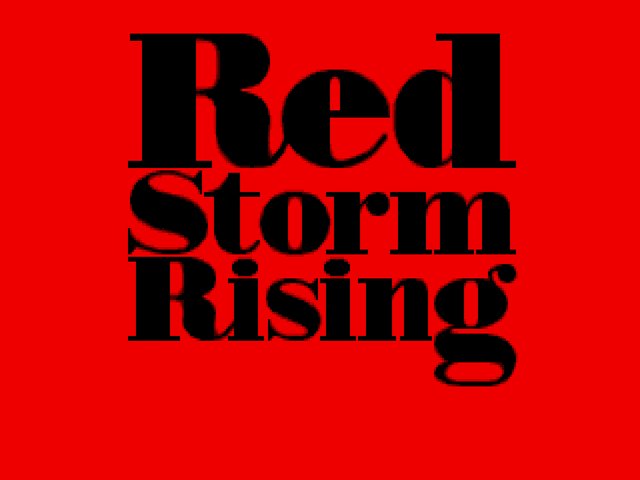
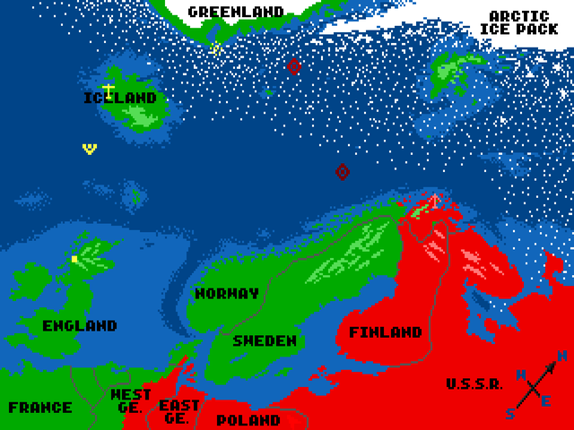
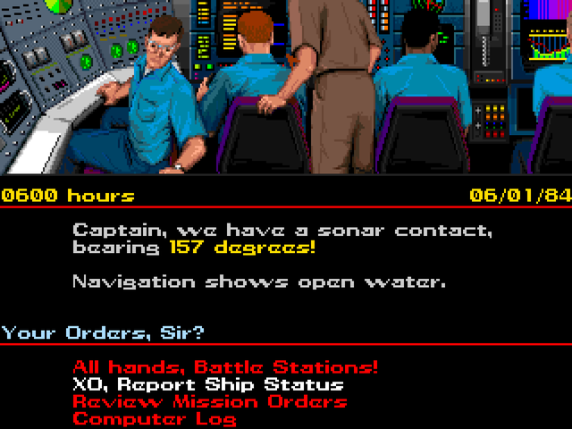
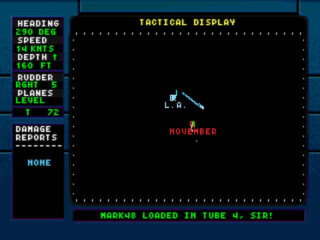
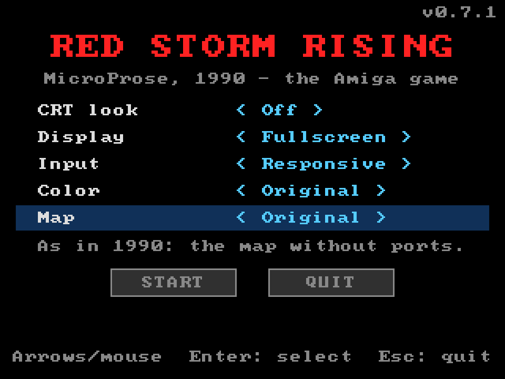

# Red Storm Rising port

Red Storm Rising (MicroProse, 1990), the Amiga game, as C++ for Linux and
Windows with SDL3. The game's logic was translated routine by routine
from the original 68000 code into readable C++. It runs on a small model
of the Amiga it was written for, so it plays exactly as the original,
frame for frame.

The approach comes from Ingo Ruhnke's
[fa18-interceptor-port](https://github.com/Grumbel/fa18-interceptor-port),
a port of the Amiga game F/A-18 Interceptor done the same way. It runs
the original 68000 code on a model of the Amiga and replaces it with C++
routine by routine, checked against the original at every step. This
port began as a fork of its 68000 core and Amiga runtime.

The game's files are not included: you need your own copy of the game,
either the WHDLoad install (`RedStormRising_v1.0_1603.lha`) or the two
disks of version v843.02 (`.adf`).

## Screenshots

<table>
  <tr>
    <td></td>
    <td></td>
  </tr>
  <tr>
    <td align="center">The title screen</td>
    <td align="center">The strategic map</td>
  </tr>
  <tr>
    <td></td>
    <td></td>
  </tr>
  <tr>
    <td align="center">The control room: a sonar contact</td>
    <td align="center">The tactical display in a battle</td>
  </tr>
</table>

## Building and playing

Linux (needs CMake, Ninja, a C++20 compiler and SDL3):

```sh
cmake -S . -B build -G Ninja
cmake --build build
build/rsr path/to/RedStormRising_v1.0_1603.lha   # or: build/rsr disk1.adf disk2.adf
```

- **First start:** the game's files are read from the archive or the disks,
  checked, and kept in `~/.local/share/redstormrising/data` (on Windows
  `%APPDATA%\RedStormRising\data`). After that `build/rsr` alone is enough.
- **The launch screen** comes first, and remembers your choices:
  - **CRT look:** off, or one of four CRT monitor looks.
  - **Display:** fullscreen or a window.
  - **Input:** Responsive (the default: every click and key press counts)
    or Original (as in 1990, when a quick click or quickly typed digits
    could be lost).
  - **Color:** Original (the default) or Alternative, a dark blue grid on
    the weapon control display (F2) instead of the bright cyan.
  - **Map:** Original (the default) or Detailed: the naval ports the
    briefings name marked on the strategic map with an anchor, in the
    game's own pixel style; the Soviet ports Murmansk and Arkhangel'sk also
    named.

  Then Start or Quit. Any command-line option skips it; `build/rsr --help`
  lists them.

  

- **Keys:** [`docs/keys.pdf`](docs/keys.pdf) is a one-page cheat sheet.
  The game is played with keyboard and mouse.

Windows: `tools/package-windows.sh` cross-compiles with MinGW and builds
`dist/RedStormRising-windows.zip`; players put the `.lha` or the disks next
to `rsr.exe`. See [`docs/README.md`](docs/README.md).

## Downloads

Ready-made packages for Windows and Linux (x86-64) are on the
[Releases](https://github.com/s-papanastasiou/redstormrising-port/releases)
page. Unpack one, put your `.lha` or the two `.adf` files next to the
program, and start it. Each package holds the program only, with its
source code and licence; the game's files come from your copy.

## Documentation

[`docs/`](docs/README.md) has the documentation:

- [`architecture.md`](docs/architecture.md): how the port works.
- [`game-code.md`](docs/game-code.md): a guide to the game's code.
- [`conventions.md`](docs/conventions.md): how to read the code.
- [`testing.md`](docs/testing.md): the gate and the tests.
- [`known-issues.md`](docs/known-issues.md): known issues.
- [`reverse-engineering.md`](docs/reverse-engineering.md): what was found
  out about the original game.
- [`history/restructure-strategy.md`](docs/history/restructure-strategy.md):
  the plan and log of how the code got to its present form.

Every change must pass the gate: `bash tests/check_native.sh SCRATCH_DIR`.

## License

The port's code is free software under the **GNU General Public License,
version 3 or later** (GPL-3.0-or-later): see [`LICENSE`](LICENSE). Each
source file names its copyright holders and licence in SPDX lines.

- **The machine model:** parts of `src/amiga`, `src/present`,
  `src/main.cpp` and the build come from
  [fa18-interceptor-port](https://github.com/Grumbel/fa18-interceptor-port)
  by Ingo Ruhnke (GPL-3.0-or-later), and keep his copyright.
- **The bundled CRT shaders** (`data/shaders/libretro`) keep their own
  licences: GPL-2.0-or-later, MIT, public domain. See
  `data/shaders/libretro/README.md`.
- **SDL3**, shipped as `SDL3.dll` in the Windows package, is under the
  zlib licence.
- **The game itself:** Red Storm Rising, its programs, pictures, sounds,
  texts and manual, remains the copyright of its owners (MicroProse,
  1990). None of it is part of this repository or of the packages built
  from it: players need their own copy of the game.
